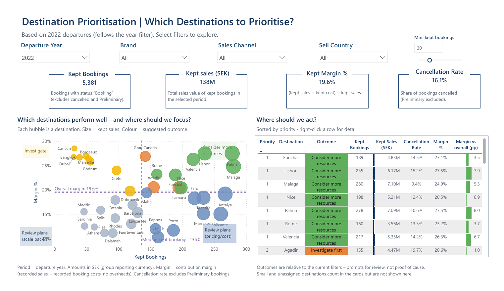
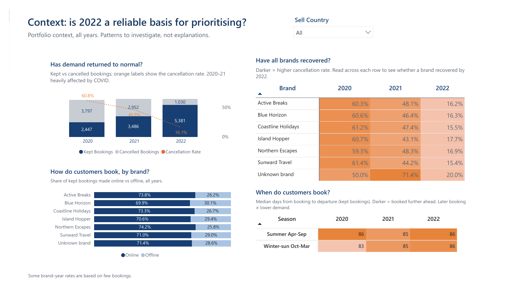
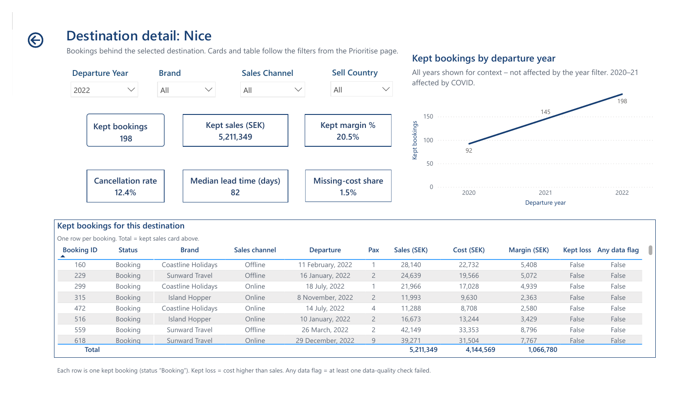
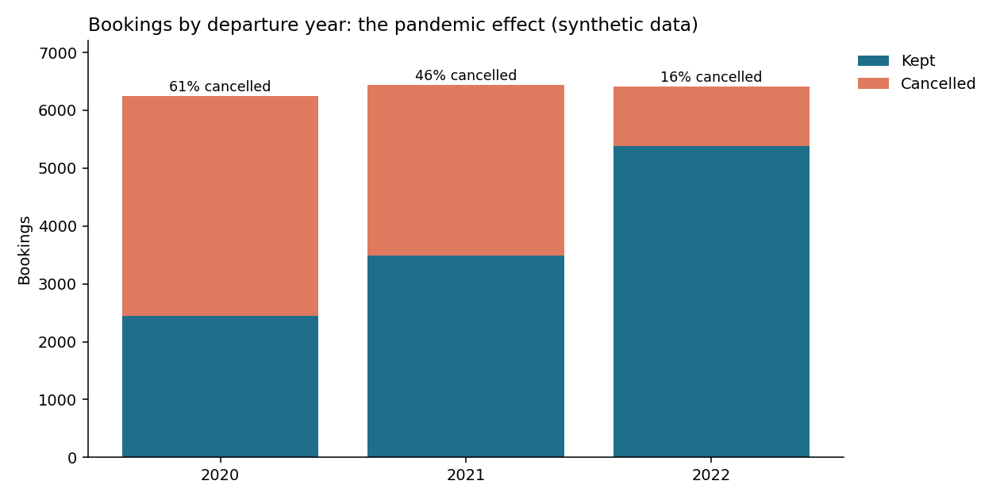
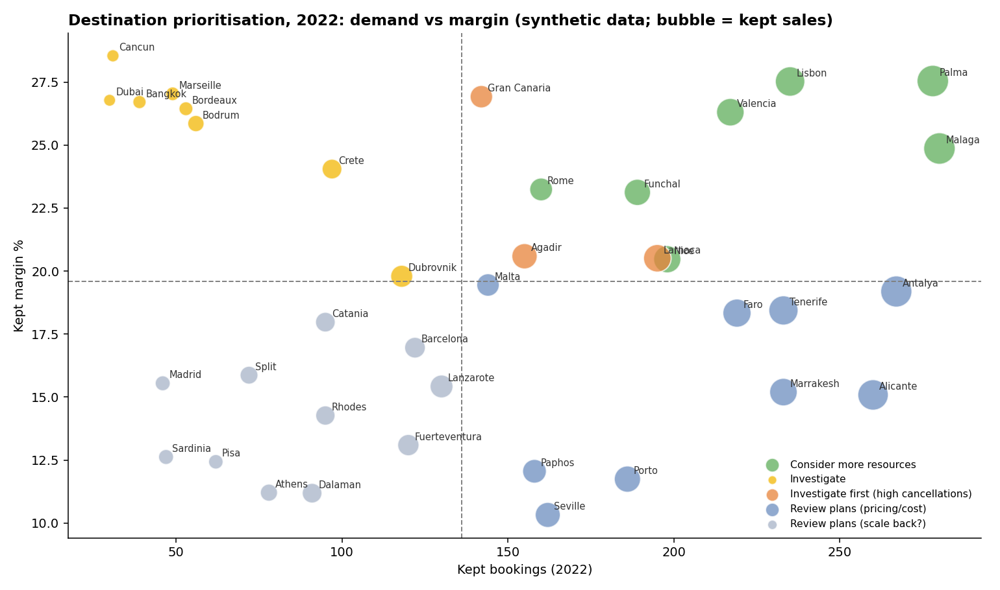
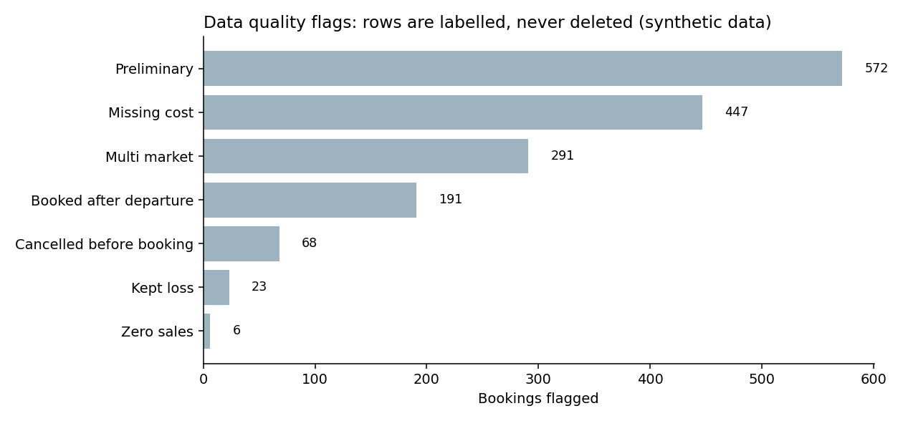

# Destination Prioritisation: BI Analysis for a Travel Company

An end-to-end analysis that turns raw booking, cost and travel data into a validated table for a Power BI dashboard, and a transparent decision rule for which destinations to invest in, investigate or scale back.

**Hyper Island · Business Intelligence · October 2026 · Pass with Distinction · Team project**

> Built for a client under NDA. The code is generalised and **all data is synthetic**: [`generate_dummy_data.py`](generate_dummy_data.py) creates six input files with the same structure, columns and row counts as the original data.



## The question

A travel company's commercial manager asked: **which brands and destinations should we prioritise or review, based on demand, cancellations, sales and margin from 2020 to 2022?**

## The Power BI dashboard

Three pages, all built on the notebook's output table (shown here with synthetic data):

| Page | Purpose |
|---|---|
| **Prioritise** | KPIs, a demand-vs-margin bubble chart and a ranked action table, with filters for year, brand, sales channel, sell country and the minimum-bookings threshold |
| **Context** | Is the analysis year a reliable basis? Demand recovery after the pandemic, cancellation rates by brand and year, booking channels and lead times |
| **Destination detail** | Drill-through for one destination, down to individual bookings and their data-quality flags |





| File | What it is |
|---|---|
| [`powerbi/destination_prioritisation_dashboard.pbix`](powerbi/destination_prioritisation_dashboard.pbix) | The report with synthetic data loaded |
| [`powerbi/destination_prioritisation_dashboard.pbit`](powerbi/destination_prioritisation_dashboard.pbit) | Template: report, data model and DAX, without data |
| [`powerbi/destination_prioritisation_dashboard.pdf`](powerbi/destination_prioritisation_dashboard.pdf) | PDF export of all three pages |

## What's in the notebook

[`destination_prioritisation_analysis.ipynb`](destination_prioritisation_analysis.ipynb) covers the full workflow in one place:

| Section | What it does |
|---|---|
| **1–2. Load and explore** | Six input tables: a sales and cost fact table (150,631 rows) plus booking, passenger, transport, market and product group dimensions |
| **3. Data quality checks** | Duplicates, missing values, key integrity, destinations, dates, amounts and outliers, all recorded in a quality log |
| **4. Preparation decisions** | Missing values are labelled or flagged, and **no rows are deleted**, so totals always reconcile with the source |
| **5. Joins** | A master table plus a booking-level table (one row per booking), extended into the **48-column Power BI table** |
| **6. Reconciliation** | 14 checks, for example that sales, cost, passengers and row counts all match the raw data. The Power BI file is only saved if every check passes |
| **7. Export** | `booking_level_powerbi.csv` for Power BI, a known-answer test, a quality log and an exceptions file |
| **8. Findings** | Demand, cancellations, sales and margin by brand, destination and channel, plus the decision rule, robustness and stability checks |



## The decision rule

Each destination is compared with the others in the same year:

| Signal | Rule |
|---|---|
| **Demand** | Kept bookings above the median destination |
| **Margin** | Kept margin % above the overall margin % |
| **Cancellations** | Cancellation rate above the overall rate |

| Outcome | When |
|---|---|
| **Consider more resources** | High demand and high margin |
| **Investigate first (high cancellations)** | High demand and high margin, but cancellations above average |
| **Review plans (pricing/cost)** | High demand, low margin |
| **Investigate** | Low demand, high margin |
| **Review plans (scale back?)** | Low demand and low margin |



Destinations with fewer than 30 kept bookings are *too small to classify*. The notebook tests whether the outcome changes with a different minimum (robustness), and whether destinations keep the same outcome from one year to the next (stability). The Power BI dashboard uses the same rule in DAX, and the notebook acts as its independent check.

## Data quality: flag, don't delete



## Run it

```bash
pip install -r requirements.txt
python3 generate_dummy_data.py       # creates the six input files in data/
jupyter notebook destination_prioritisation_analysis.ipynb   # run all cells
```

The notebook writes `output/booking_level_powerbi.csv` (19,665 rows × 48 columns), the table the Power BI dashboard loads. To use it with the template, open the `.pbit` in Power BI Desktop and point the data source to this file (Transform data → Data source settings → Change Source).

## Repository structure

```
destination_prioritisation_analysis.ipynb   Full analysis, Power BI table and findings
powerbi/                                    Dashboard (.pbix with synthetic data), template (.pbit) and PDF
generate_dummy_data.py                      Synthetic input data (fixed seed, same structure as the original)
images/                                     Dashboard screenshots and charts (synthetic data)
requirements.txt
```

## Built with

Python · pandas · NumPy · Matplotlib · Jupyter · Power BI · DAX
